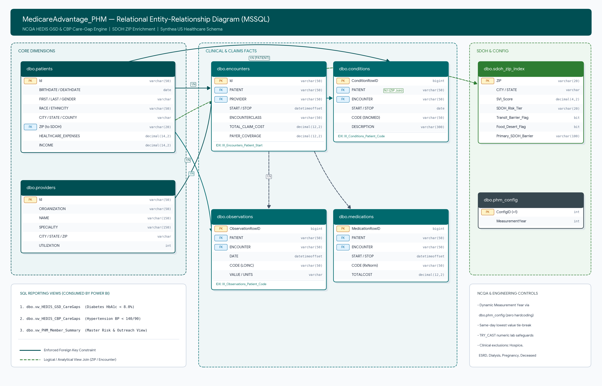
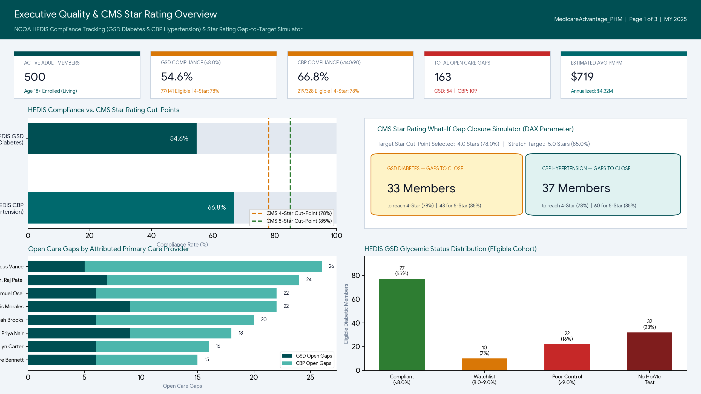
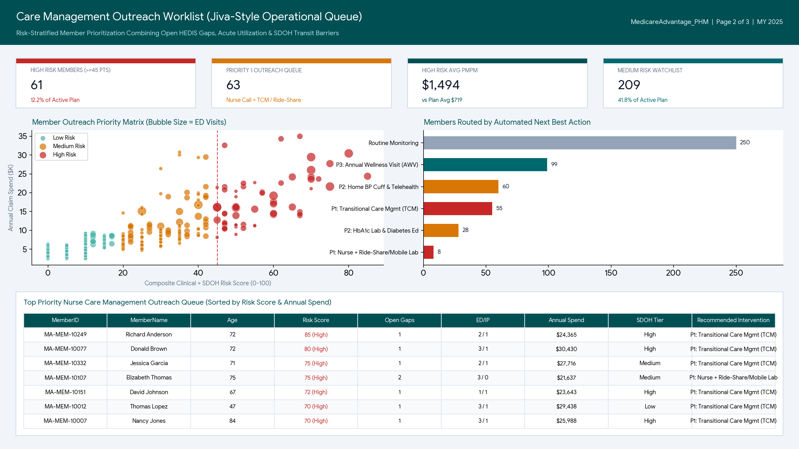
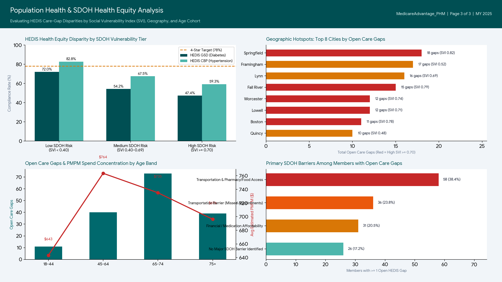

# Medicare Advantage HEDIS Care-Gap & Population Health Management (PHM) Solution


An end-to-end **Business Analysis & Population Health Management (PHM)** solution built for a simulated US Medicare Advantage health plan. This project translates **NCQA HEDIS** technical specifications into a complete **Business Requirements Document (BRD)**, relational **ER Diagram**, **18-scenario UAT test suite**, production **T-SQL care-gap views**, and an interactive **3-page Power BI Care Management Dashboard**.

---

## Business Problem & Strategic Objective

A regional Medicare Advantage (MA) plan holds a **3.5-Star CMS Rating**, falling short of the **4.0-Star threshold** required to unlock CMS Quality Bonus Payments (QBPs). Operational review identified three core bottlenecks:
1. **Fragmented Clinical & Claims Data:** Member eligibility, claims utilization, SNOMED diagnoses, and LOINC lab/vital records live in disconnected tables with no unified care-gap logic.
2. **Reactive Quality Reporting:** Open preventive care gaps for high-weight chronic measures (**Diabetes GSD** and **Hypertension CBP**) are surfaced too late in the measurement year to intervene.
3. **Unprioritized Care Management Outreach:** Care managers lack a single risk-stratified queue combining open HEDIS gaps, acute utilization (ED/Inpatient), and **Social Determinants of Health (SDOH)** barriers.

**Solution:** An automated **MSSQL + Power BI** PHM pipeline that identifies audit-ready HEDIS care gaps, calculates a 0–100 composite member risk score, routes members to tailored Next Best Action interventions, and lets Quality Directors simulate exact gap closures needed to reach **4.0 and 5.0 CMS Stars**.

---

## Business Analysis Artifacts (Deliverables)

| Artifact | Purpose | File Link |
| :--- | :--- | :--- |
| **Business Requirements Document (BRD)** | Scope, stakeholder personas, NCQA measure specs, 10 Functional Requirements (`FR-01`–`FR-10`), 5 NFRs, 4 Gherkin User Stories, and sign-off | [`01_BA_Documentation/BRD_HEDIS_CareGap_PHM.pdf`](01_BA_Documentation/BRD_HEDIS_CareGap_PHM.pdf) |
| **Relational ER Diagram** | 8-table SQL Server schema with PK/FK relationships, performance indexes, and SDOH enrichment joins (`.dbml` + `.png`) | [`01_BA_Documentation/ER_Diagram_PHM_Schema.png`](01_BA_Documentation/ER_Diagram_PHM_Schema.png) |
| **UAT Test Suite & Sign-Off Tracker** | 18 test cases (`TC-01`–`TC-18`) mapped 1-to-1 to `FR-01`–`FR-10` with dynamic pass-rate scorecards & chart | [`01_BA_Documentation/UAT_Test_Cases_HEDIS.xlsx`](01_BA_Documentation/UAT_Test_Cases_HEDIS.xlsx) |
| **T-SQL Schema & HEDIS Engine** | DDL, dynamic config (`dbo.phm_config`), HEDIS GSD & CBP views, SDOH scoring, and master PHM reporting view | [`02_SQL_Server_Scripts/`](02_SQL_Server_Scripts/) |
| **Power BI Dashboard Kit & DAX** | Complete DAX measures, 500-member synthetic dataset matching `vw_PHM_Member_Summary`, and 3 dashboard layouts | [`03_PowerBI_Dashboard/PowerBI_Build_Guide_and_DAX.md`](03_PowerBI_Dashboard/PowerBI_Build_Guide_and_DAX.md) |

---

## Solution Architecture & Clinical Logic



### 1. NCQA HEDIS Measure Specifications (T-SQL Views)

| Measure | SQL View | Eligible Denominator | Clinical Exclusions | Compliance & Tie-Breaking Rules |
| :--- | :--- | :--- | :--- | :--- |
| **GSD** *(Glycemic Status Assessment — Diabetes)* | `dbo.vw_HEDIS_GSD_CareGaps` | Active members aged **18–75** with Type 1/2 Diabetes active in MY or MY-1 | Deceased, Hospice, Palliative Care | Latest MY HbA1c (`LOINC 4548-4`, `17855-8`, `17856-6`, `4549-2`); **same-day ties broken by lowest value**; Compliant `< 8.0%`, Watchlist `8.0%–9.0%`, Open Gap `> 9.0%` or Missing |
| **CBP** *(Controlling High Blood Pressure)* | `dbo.vw_HEDIS_CBP_CareGaps` | Active members aged **18–85** with Hypertension (`SNOMED 59621000`) active in MY or MY-1 | Deceased, Hospice, Palliative, ESRD/Dialysis, Kidney Transplant, Pregnancy | Requires **paired** Systolic (`8480-6`) & Diastolic (`8462-4`) on the same date on/after diagnosis; **lowest same-day Sys/Dia** selected; Compliant `< 140/90 mmHg` |

### 2. Composite Risk Stratification (0–100 Scale) & Outreach Routing (`dbo.vw_PHM_Member_Summary`)

* **Weighted Risk Points:** Open GSD Gap (`+20`), Open CBP Gap (`+15`), `>= 2` ED Visits (`+25`) or `1` ED Visit (`+12`), `>= 1` Inpatient Admission (`+20`), `>= 5` Active Chronic Conditions (`+10`), High SDOH Vulnerability (`+10`) or Medium SDOH (`+5`).
* **Risk Tiers:** **High Risk** (`>= 45`), **Medium Risk** (`20–44`), **Low Risk** (`< 20`).
* **Automated Next Best Action (`Recommended_Intervention`):**
  1. **Priority 1:** `>= 2` Open Gaps + Transit Barrier (`SVI >= 0.65`) → *Nurse Care Manager Call + Ride-Share / Mobile Phlebotomy*
  2. **Priority 1:** `>= 1` Open Gap + Recent ED/Inpatient Event → *Transitional Care Management (TCM) + PCP Follow-up*
  3. **Priority 2:** Open GSD Gap → *Schedule HbA1c Lab & Diabetes Educator Outreach*
  4. **Priority 2:** Open CBP Gap → *Home BP Cuff Dispatch & Telehealth Medication Review*
  5. **Priority 3:** Age `>= 65` & Zero Wellness Visits → *Annual Wellness Visit (AWV) Reminder Campaign*

---

## Power BI Dashboard Highlights

### Page 1 — Executive Quality & CMS Star Rating Overview


### Page 2 — Care Management Outreach Worklist


### Page 3 — Population Health & SDOH Equity Analysis


---

## Repository Structure

```text
medicare-advantage-hedis-phm-dashboard/
├── 01_BA_Documentation/
│   ├── BRD_HEDIS_CareGap_PHM.pdf
│   ├── ER_Diagram_PHM_Schema.dbml
│   ├── ER_Diagram_PHM_Schema.png
│   └── UAT_Test_Cases_HEDIS.xlsx
├── 02_SQL_Server_Scripts/
│   ├── 01_schema_ddl.sql
│   ├── 02_hedis_gsd_care_gaps.sql
│   ├── 03_hedis_cbp_care_gaps.sql
│   ├── 04_sdoh_enrichment.sql
│   └── 05_phm_risk_and_outreach_view.sql
├── 03_PowerBI_Dashboard/
│   ├── PowerBI_Build_Guide_and_DAX.md
│   ├── sample_vw_PHM_Member_Summary.csv
│   └── screenshots/
│       ├── page1_executive_stars.png
│       ├── page2_care_management_worklist.png
│       └── page3_sdoh_equity.png
└── README.md
```

---

## How to Reproduce Locally

1. **Download Synthetic US Patient Data:** Download the CSV archive from [Synthea Synthetic Patient Generator](https://synthea.mitre.org/downloads) (1K or 10K sample).
2. **Initialize Database:** Run `02_SQL_Server_Scripts/01_schema_ddl.sql` in **SQL Server Management Studio (SSMS)**.
3. **Import CSVs (in FK order):** Load `providers.csv`, `patients.csv`, `encounters.csv`, `conditions.csv`, `observations.csv`, and `medications.csv` into `MedicareAdvantage_PHM`.
4. **Build Analytics & Views:** Execute scripts `02_hedis_gsd_care_gaps.sql`, `03_hedis_cbp_care_gaps.sql`, `04_sdoh_enrichment.sql`, and `05_phm_risk_and_outreach_view.sql` sequentially.
5. **Build & Save Power BI Dashboard:** Follow `03_PowerBI_Dashboard/PowerBI_Build_Guide_and_DAX.md` (connecting to `dbo.vw_PHM_Member_Summary` or `sample_vw_PHM_Member_Summary.csv`) and save as `PHM_HEDIS_Dashboard.pbix`.

---

## Author

**Dayanand Jola Dinakar**  
*Business & Data Analyst | MS in Computer Science (AI Systems & ML Engineering) | MSc in Computing & IT Management*  
* **Email:** imdayanandjd@gmail.com  
* **LinkedIn:** [linkedin.com/in/your-profile](https://linkedin.com)  
* **GitHub:** [github.com/your-username](https://github.com)

> **Data Privacy Notice:** All patient, provider, and claims records used in this repository are 100% synthetic data and contain zero Protected Health Information (PHI).
